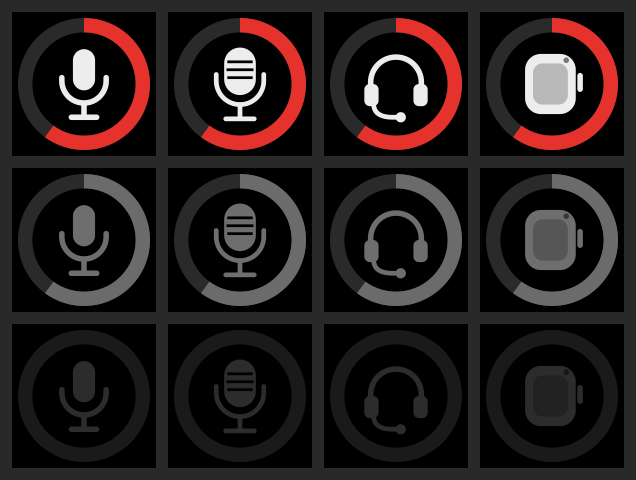

# Mic Control for Stream Deck

A Stream Deck plugin for macOS that mutes a microphone **at system level** and adjusts its input level. Every app (Zoom, Teams, OBS, the browser) hears silence while muted, and all other input devices stay untouched.



The key shows a ring around a microphone icon:

| Ring | Meaning |
|---|---|
| red, filled to the level | live |
| grey, filled to the level that unmute will restore | muted |
| empty, dark icon | device not connected |
| small orange dot | Accessibility not granted (only needed for adjusting) |

## Usage

| Action | Effect |
|---|---|
| short press (< 400 ms) | mute / unmute (back to the previous level, otherwise 50 %) |
| hold + arrow up/down | ±1 % (with Shift ±5 %), key repeat keeps counting |
| hold + scroll wheel / trackpad | ±1 % per notch (wheel) or per 12 pt (trackpad) |
| hold without adjusting | nothing, so you can't toggle by accident |

While you hold the key, the arrow keys and scroll events go only to the plugin: the app in front does not scroll.

### Settings (Property Inspector)

- **Input device:** *System default input* (follows macOS) or a specific device. Fixed devices are identified by their UID, so they are found again after unplugging and replugging.
- **Icon:** microphone, studio mic, headset, clip-on transmitter, or **your own image** (PNG/JPG/SVG, ideally with a transparent background). A muted variant is generated automatically (grey, 50 % darker).
- **Level on unmute:** used when no previous level is known (default 50 %).
- **Show % while adjusting**, **Shift = ±5 %**

## Which devices work?

Any input device for which macOS exposes a software input volume. That includes built-in microphones, most USB microphones and wireless receivers (e.g. DJI Mic, Rode Wireless), AirPods and many headsets. Devices without one are listed as *not adjustable*. This applies to many audio interfaces whose gain is a physical knob, and to iPhone Continuity microphones.

To check your devices, build the plugin (see below) and run:

```bash
io.github.marvin-bay.miccontrol.sdPlugin/bin/mic-control-helper --list
```

**Level steps:** many devices have coarse internal steps. The DJI Mic receiver, for example, has 30 steps of 3.33 %. The plugin still moves in 1 % steps and shows the value you set, while the device snaps to its nearest step. A change made elsewhere (System Settings, another app) always takes over.

## Installation

Requirements: macOS 13+, Stream Deck 7.1+, Xcode Command Line Tools (`xcode-select --install`), Node.js 20+ (23+ for `npm run icons`).

```bash
git clone https://github.com/marvin-bay/streamdeck-mic-control.git
cd streamdeck-mic-control
npm install
npm run build      # native helper (Swift, universal binary) + plugin (TypeScript)
npm run link       # registers the plugin with Stream Deck (once)
npm run restart    # after every rebuild
```

Then drag **Mic Control** from the action list onto a key.

To create an installable `.streamDeckPlugin` file to share, run `npm run pack`. The file ends up in `dist/`.

### Accessibility permission

Catching arrow keys and scroll events needs the macOS Accessibility permission. **Mute and the display work without it.** The first time you hold the key, System Settings opens and `mic-control-helper` is listed under *Privacy & Security → Accessibility*. Switch it on.

- The helper relaunches itself in its own security context, so the permission applies to this small helper only, not to the whole Stream Deck app.
- The default build is ad-hoc signed, so macOS asks again after every rebuild of the helper. With your own certificate the permission survives rebuilds:
  `CODESIGN_IDENTITY="Apple Development: Your Name (TEAMID)" npm run build:helper`

## Development

```bash
npm test           # unit tests (key logic, rendering)
npm run typecheck
npm run watch      # rebuild + restart on change
npm run icons      # regenerate imgs/ from the vector icons
npm run validate   # Stream Deck manifest check
```

Logs are written to `io.github.marvin-bay.miccontrol.sdPlugin/logs/`.

### Architecture

Stream Deck plugins run in Node.js. They only receive key events and can't reach Core Audio. The plugin therefore has two parts:

```
Stream Deck ──keyDown/keyUp──▶ bin/plugin.js (Node, TypeScript)
                                 │ stdin/stdout, one JSON object per line
                                 ▼
                               bin/mic-control-helper (Swift)
                                 ├─ Core Audio: find device, read/set level,
                                 │  listeners for level, device list, default input (no polling)
                                 └─ CGEventTap: arrows/scroll, active only while the key is held
```

| File | Purpose |
|---|---|
| `helper/main.swift` | native helper: Core Audio, event tap, own TCC context |
| `src/controller.ts` | states, short/long press, adjust mode, level quantisation (SDK-free, tested) |
| `src/render.ts` | SVG key image and the vector icon sets |
| `src/actions/mic-control.ts` | Stream Deck action: one helper + controller per key, drawing throttled to 20 fps |
| `src/store.ts` | remembered level per device UID (global plugin settings) |
| `*.sdPlugin/ui/mic-control.html` | Property Inspector (English/German) |

Protocol:

- **Plugin → helper:** `setDevice{uid?}`, `setLevel{value}`, `getLevel`, `listDevices`, `adjustStart`, `adjustEnd`, `checkAccess`, `requestAccess`
- **Helper → plugin:** `hello`, `level{value}`, `device{connected,uid,name,adjustable,followsDefault}`, `devices{list}`, `step{delta,shift}`, `access{trusted}`, `error{message}`

Timings are in `src/controller.ts` → `TIMING`. The trackpad sensitivity is `pointsPerStep` in `helper/main.swift`.

## Limitations

- macOS only. Windows would need a separate helper.
- Mute means "input level 0". A device without a software input volume can't be muted this way.
- Stream Deck + dials are not supported yet; they would be a natural fit for the level.

## License

[MIT](LICENSE). Not affiliated with Elgato or any microphone manufacturer.
